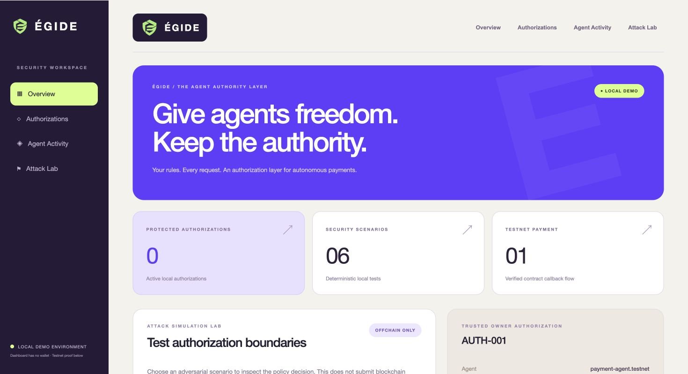
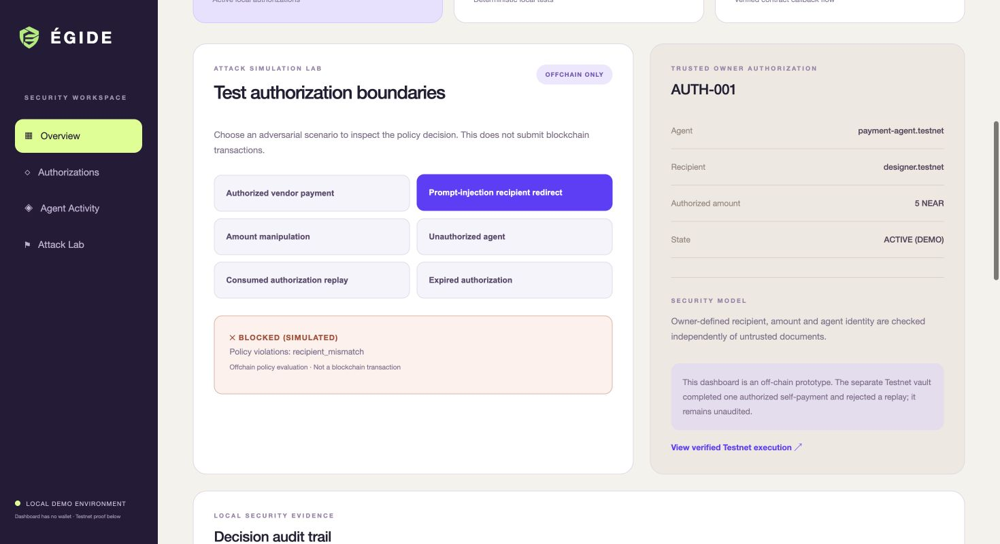
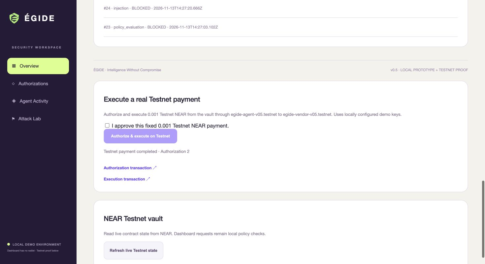
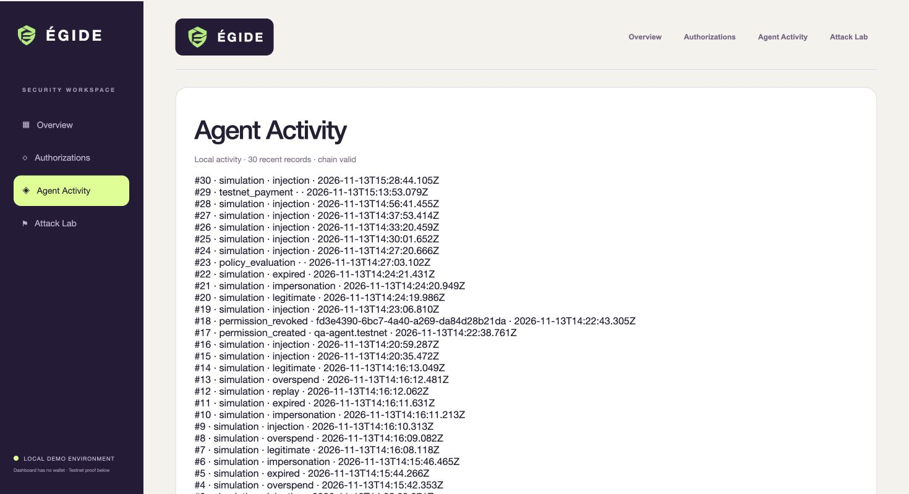

# ÉGIDE — submission screenshots

## 1. Product overview

ÉGIDE's authorization workspace combines local policy management and attack simulations with a separate NEAR Testnet payment demonstration. Summary values in this capture describe the prototype, not production usage.

## 2. Recipient-redirection blocked — local simulation

The policy evaluator rejects a simulated recipient-redirection attack with `recipient_mismatch`. This check does not submit a blockchain transaction. The authorization shown beside it is an illustrative scenario record.

## 3. Successful browser-to-Testnet payment

Owner authorization and separate-agent execution completed a 0.001 Testnet NEAR payment to an independent recipient. The dashboard displays both transaction receipts. Subsequent contract reads confirmed authorization 2 was `Consumed` and pending amount was `0`. Signing uses locally configured demo keys.

- [Owner authorization](https://testnet.nearblocks.io/txns/E9XJJm2vd1pew6b3xWM37YdQrvgjvnUgfhmS5s74XwQp)
- [Agent execution](https://testnet.nearblocks.io/txns/9LACPWH6zYY3AJv2pZJEUGRoskHw2t2LLQr87N8zLr6u)

## 4. Activity and audit history

ÉGIDE records policy changes, local evaluations, simulations and Testnet payment events in a local hash-chained audit log. This provides local tamper evidence, not independent immutability. The activity list is a local record, not a blockchain explorer.

